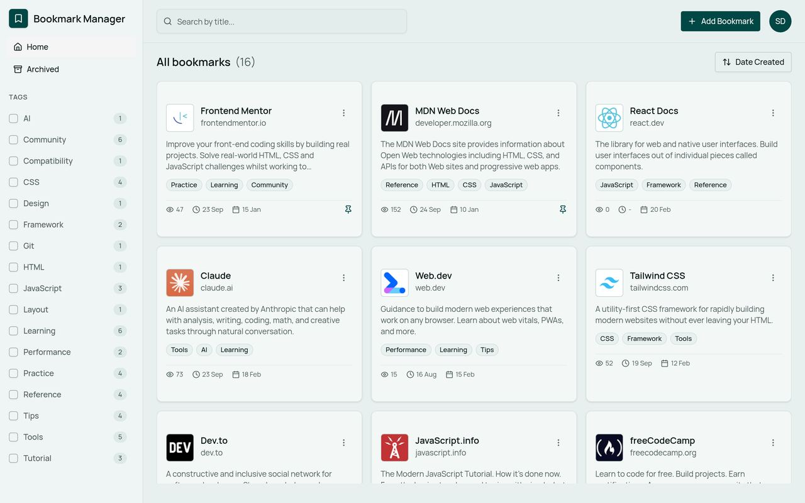
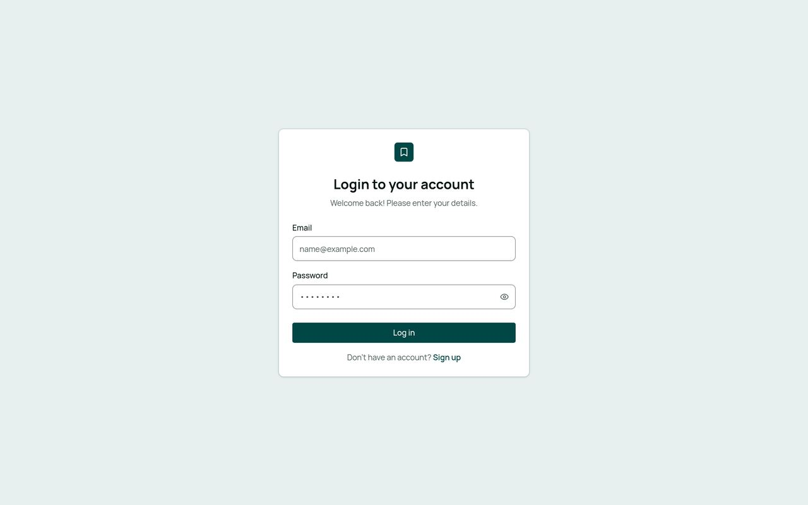
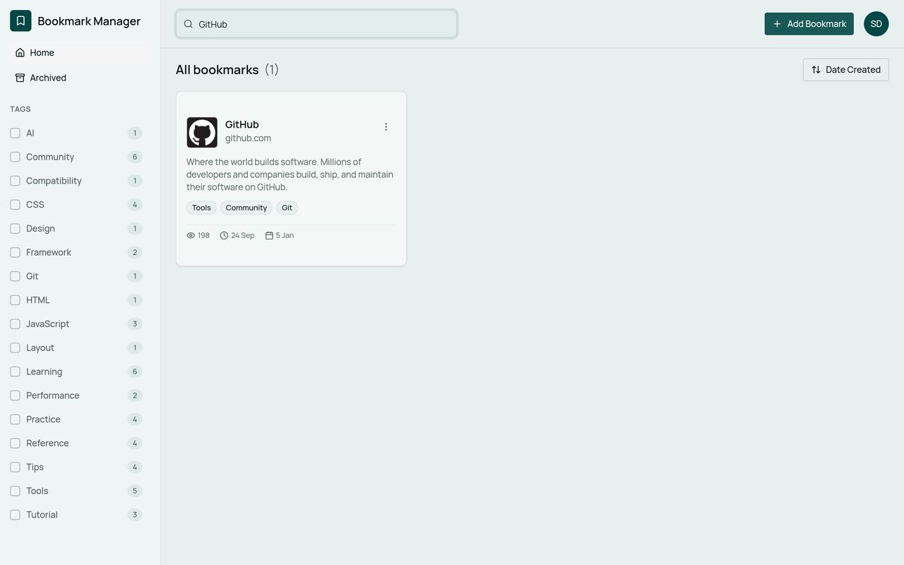
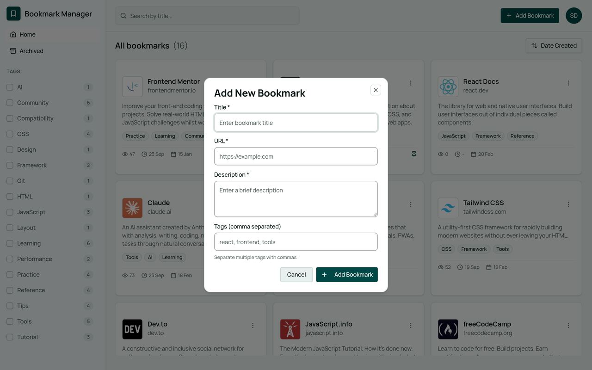

# Bookmark Manager

تطبيق ويب حديث لإدارة الإشارات المرجعية (Bookmarks) بطريقة منظمة وسهلة البحث، مبني بـ **React** و **TypeScript** و **Vite**.

---

## 1) عرض المشروع وهو شغال

### لوحة الإشارات المرجعية


### تسجيل الدخول


### البحث والفلترة


### إضافة Bookmark جديد


---

## 2) المشكلة التي يحلها والفئة المستهدفة

### المشكلة
متصفحات الويب تحفظ الروابط في قائمة مسطحة يصعب تنظيمها مع الوقت:

- الروابط تتراكم بدون وصف أو تصنيف واضح
- البحث داخل bookmarks المتصفح ضعيف وغير مرن
- لا يوجد تتبع لعدد الزيارات أو آخر زيارة
- صعوبة فصل الروابط المهمة (Pinned) عن المؤرشفة أو القديمة

**Bookmark Manager** يحل هذه الفوضى عبر واجهة واحدة تجمع الروابط مع **وصف، تاجات، بحث، ترتيب، تثبيت، وأرشفة**.

### الفئة المستهدفة
- **المطورون والمصممون** الذين يجمعون وثائق، أدوات، ومراجع تقنية يومياً
- **الطلاب والمتعلمون** الذين يحتاجون مكتبة روابط منظمة للتعلم
- **أي مستخدم** يتعامل مع عدد كبير من الروابط ويريد بديلاً أوضح من Bookmarks المتصفح

---

## 3) أهم الفيتشرز والتحديات التي تم حلها

### أهم الفيتشرز التي طوّرتها

| الميزة | التفاصيل |
| --- | --- |
| **Authentication** | تسجيل دخول / إنشاء حساب مع حماية للصفحات (Protected Routes) |
| **CRUD كامل للـ Bookmarks** | إضافة، عرض، تعديل، وحذف الروابط |
| **نظام التاجات (Tags)** | تصنيف الروابط وفلترتها من الـ Sidebar مع عدّاد لكل تاج |
| **Pin & Archive** | تثبيت الروابط المهمة وأرشفة القديمة بدون حذفها |
| **بحث وترتيب** | بحث بالعنوان + ترتيب حسب العنوان / التاريخ / عدد الزيارات / آخر زيارة |
| **Visit Tracking** | تتبع عدد الزيارات وآخر زيارة لكل رابط |
| **Dark / Light Theme** | دعم الثيم الفاتح والداكن |
| **Responsive UI** | واجهة متجاوبة مبنية على shadcn/ui و Tailwind CSS |
| **Dev Mode بـ localStorage** | تشغيل كامل بدون Backend للتجربة والتطوير المحلي |

### التحديات التي تم حلها

1. **تنظيم البيانات بدون Backend حقيقي**  
   بناء طبقة Services مرنة تعمل في `DEV_MODE` عبر `localStorage`، مع إمكانية التحويل لاحقاً إلى API بدون إعادة كتابة الواجهة.

2. **هيكلة المشروع بشكل قابل للتوسع**  
   فصل واضح بين: Views، Components، Services، Contexts، Schemas، و Utils — بدل تجميع كل المنطق في ملفات كبيرة.

3. **فلترة وترتيب ديناميكي**  
   دمج البحث + التاجات + خيارات الفرز + حالة الأرشفة في تجربة واحدة سلسة بدون تعقيد الواجهة.

4. **إدارة الحالة والحماية**  
   مزامنة حالة المصادقة مع `localStorage`، وحماية المسارات عبر `ProtectedRoute` لتفادي الوصول غير المصرح به.

5. **تحقق النماذج (Validation)**  
   استخدام **React Hook Form** مع **Zod** لضمان إدخال صحيح للبريد، كلمة المرور، والـ URL قبل الحفظ.

6. **تجربة مستخدم واضحة**  
   بطاقات bookmarks مع Favicon، وصف، تاجات، وإحصائيات زيارة — بدل قائمة روابط جافة.

---

## التقنيات المستخدمة

- React 19 + TypeScript
- Vite
- React Router
- React Hook Form + Zod
- Tailwind CSS + shadcn/ui
- next-themes + Sonner

---

## التشغيل المحلي

```bash
# تثبيت الحزم
npm install

# تشغيل بيئة التطوير
npm run dev

# بناء نسخة الإنتاج
npm run build

# معاينة نسخة الإنتاج
npm run preview
```

> التطبيق يعمل افتراضياً في **Development Mode** ويحفظ البيانات في `localStorage` بدون الحاجة لسيرفر.

للتبديل إلى وضع الإنتاج (API)، عدّل `DEV_MODE` في:

- `src/services/authService.ts`
- `src/services/bookmarkService/constants.ts`

---

## هيكل المشروع (مختصر)

```text
src/
├── components/     # مكونات مشتركة (forms, ui, bookmarks)
├── context/        # Auth / Theme / Tags
├── services/       # طبقة البيانات والمصادقة
├── views/          # صفحات Login / Signup / Bookmarks
├── router/         # المسارات والحماية
├── schemas/        # Zod schemas
└── utils/          # أدوات مساعدة
```

---

Built with React & TypeScript
